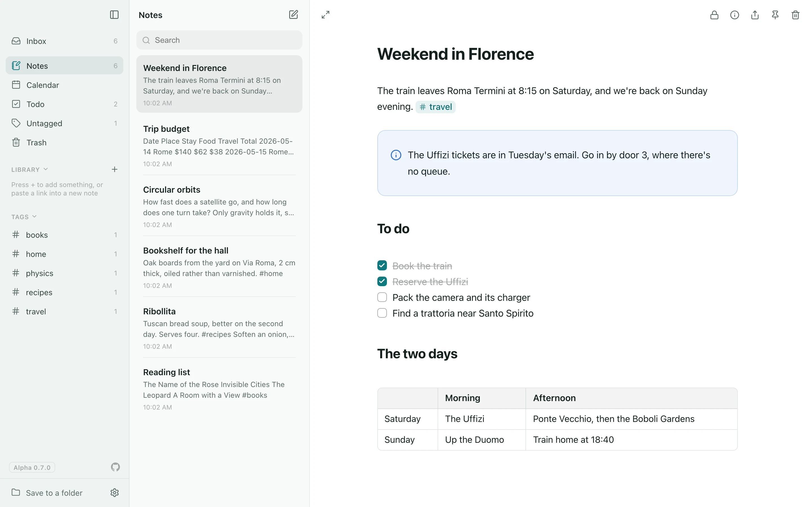

# Lines

**A calm, private space for everything you keep.**

Your notes and ideas, the books, films and podcasts you love, and the week ahead, together in one quiet place. Lines lives on your device, so there's no account to make. Sync it where you choose, or not at all. It's free and open source, and it works on your computer and in your browser, with phone apps on the way.

**[Open Lines in your browser →](https://olekslitus.com/lines/app/)** Nothing to install. Or [download the app](https://olekslitus.com/lines/#download) for Mac, Windows or Linux. The website also has [the docs](https://olekslitus.com/lines/docs/).

<picture>
  <source media="(prefers-color-scheme: dark)" srcset="site/images/app-dark.webp">
  
</picture>

> [!WARNING]
> **Lines is new, and still in alpha.** It changes often and may have bugs. Please don't keep your only copy of anything important in it yet, and export your notes now and then (Settings → Export and Import → Export).

## What you can do with it

The quickest way to see it all is [the web app](https://olekslitus.com/lines/app/): it opens with a short tour, one note for each thing Lines does, to read and play with.

### Write and think

A quiet page that gets out of your way. Type the way you think, and Lines tidies it up as you go.

- Headings, lists, todos, tables and callouts take shape as you type. Type `/` for anything else.
- Underneath, it's plain Markdown, so every note opens in any other app. Put your cursor on a line to see its Markdown again, or hide it for good.
- Tags instead of folders. New notes wait in the Inbox until you file them.
- Link notes with `@` or `[[`. Give a note a type, like `person` or `recipe`, and see all of them together.
- Search finds anything, across every note, as you type.
- Pictures, files, audio, video, math, drawings and diagrams sit right in the note.
- Small things help: drag any line to move it, find and replace, arrows that draw themselves (`->` as →), notes side by side, and, on a computer, a note in a small window of its own that can stay on top.

### Keep what you read, watch and listen to

The Library is a home for books, comics, films, shows, anime, music, podcasts, videos and articles. See [the Library](docs/library.md).

- Paste a link, and the note fills itself in: the title, the cover, who made it and what it's about. Only the link is sent to look it up.
- Mark where you've got to (to read, reading, read) and rate it your way: stars, out of ten, thumbs up, or a scale of your own.
- Read your own PDFs and EPUBs in Lines. Keep the lines you like as quotes, and Lines remembers your page.
- Follow blogs, sites and podcasts (and, in the apps, YouTube channels). Read them like an inbox you can bring to zero.
- Listen to episodes in a small player that keeps going as you move between notes. Jot notes as you listen, each one marked with the time.
- Bring in your browser's bookmarks and your Readwise highlights. Keep your AniList or MyAnimeList list in step, both ways.

### Plan your days

- A calendar of your notes: give a note a date, or a start and an end, and it's on those days.
- See your week or a day by the hour. Drag to make an event, move it, or change how long it lasts.
- Events that repeat, written the way you'd say it: `every weekday`, `monthly on the last friday`.
- One list of every open todo, gathered from all your notes.
- Choose a day and press <kbd>↵</kbd> for a note dated that day: a simple way to keep a journal.

### Yours, private and offline

Your notes are files on your device, not rows on someone else's server.

- No account, no ads and no tracking. The apps work without the internet.
- Sync if you want to: through iCloud Drive, Google Drive, Dropbox, OneDrive, Proton Drive or any folder (in the desktop apps), a folder on your computer (on the web, in Chrome and Edge), or storage of your own, such as Cloudflare R2 or Amazon S3. Edits made on two devices are never lost. See [Sync](docs/sync.md).
- Turn on end-to-end encryption, and your notes are encrypted on your device before they leave it.
- Lock single notes with a password, like in Apple Notes (or Touch ID on a Mac), and keep passwords and API keys in a locked note ([Secrets](docs/secrets.md)).
- Lock the whole app with a passphrase, or Touch ID on a Mac.
- Export everything as ordinary files whenever you like. Lines is free and open source, so it can't be taken away from you.

### Make it feel like yours

- Twenty-seven themes, each light and dark, including High Contrast and two for color blindness. Make your own, from scratch or from a picture you like, or bring one from VS Code or your terminal. See [Themes](docs/themes.md).
- Whole new looks in one click: a 90s desktop, one-bit pixels, neon, glossy glass, 1920s posters, and more.
- Paper to write on: ruled, dotted, squared or graph paper, and a soft backdrop behind the page.
- An app icon in your colors, from twenty-one: on the home screen on a phone, in the Dock or taskbar on a computer.
- Your fonts (Geist, Geist Mono, IBM Plex Sans and more come with Lines, or any on your device), text size, note width and spacing. Put the sidebar and the list where you like, and add tabs.
- A text cursor your way, typing sounds from a real keyboard, and a pixel-art cat (or alien, or slime) that keeps you company at the bottom of the page. The sounds and the cat stay off until you want them.
- Lines is made of [plugins](docs/plugins.md). Turn off what you don't use, and nothing in your notes changes.
- In English, Spanish and French. Everything works with the keyboard and with a screen reader ([Accessibility](docs/accessibility.md)).

### When a note needs to be more

- **Papers in LaTeX**, drawn as you type, with a PDF typeset right in the app ([LaTeX notes](docs/latex.md)).
- **Spreadsheets** that work like Excel, with formulas, CSV and Excel files in and out ([Spreadsheets](docs/spreadsheets.md)).
- **Diagrams** from a few lines of text: flowcharts, Gantt charts, timing diagrams, and **3D models** to turn around and print.
- **Code notes** in about 120 languages, and **API requests** you send from the note, like a lighter Postman ([API requests](docs/requests.md)).
- **Typing practice** on any text, terminal recordings, Spotify and SoundCloud players, and research papers looked up on arXiv (in the apps).

### Bring your notes with you

- Move from Obsidian, Bear, Logseq, Notion or Evernote. Your notes come over with their tags, links, pictures, files and dates. Lines tells you first what won't come across as it was, and Undo takes it all back. See [Importing](docs/importing.md).
- Open Markdown and LaTeX files as notes, and CSV and Excel files as spreadsheets.
- Take them out again any time: every note as a file in a .zip, a note as a PDF or pictures, or shared from the system's share menu.

## Get Lines

| Where | How |
| --- | --- |
| **In your browser** | [Open the web app](https://olekslitus.com/lines/app/). Nothing to install. Your notes stay in that browser, or in a folder you choose in Chrome and Edge. |
| **Mac, Windows, Linux** | [Download the app](https://olekslitus.com/lines/#download). It updates itself, and syncs through your cloud drive. |
| **Android** | An app to install yourself comes with each release from Lines 0.8 on, on [the downloads](https://olekslitus.com/lines/#download). It isn't on Google Play yet. |
| **iPhone and iPad** | Coming soon, through TestFlight. |

A few honest notes:

- **It's alpha.** Export your notes now and then, and say what breaks in [the issues](https://github.com/olekslitus/lines/issues).
- **The Mac app is signed and notarized by Apple**, so it opens like any other app. The Windows app isn't signed yet: choose More info → Run anyway.
- **On the web, the browser keeps your notes,** and a browser can clear them. Save to a folder, or export, to be safe ([Storage](docs/storage.md)).
- What doesn't work yet, and what hasn't been tried on real phones, is all in [Limitations](docs/limitations.md).

## Keyboard shortcuts

Press <kbd>⌘/</kbd> to see them all. On Windows and Linux, use <kbd>Ctrl</kbd> instead of <kbd>⌘</kbd>.

| Shortcut | What it does |
| --- | --- |
| <kbd>⌘N</kbd> | New note (<kbd>⌥N</kbd> on the web, where the browser keeps <kbd>⌘N</kbd>) |
| <kbd>⌘⇧F</kbd> | Search notes |
| <kbd>⌘F</kbd> | Find and replace in the open note |
| <kbd>⌘B</kbd> <kbd>⌘I</kbd> <kbd>⌘U</kbd> <kbd>⌘E</kbd> | Bold, italic, underline, inline code |
| <kbd>⌘⇧X</kbd> <kbd>⌘⇧H</kbd> | Strikethrough, highlight |
| <kbd>⌘↵</kbd> | Make a todo, or tick it |
| <kbd>⌘⇧M</kbd> | Mark lines in the margin, or take their marks off |
| <kbd>Tab</kbd> <kbd>⇧Tab</kbd> | Nest or un-nest a list item; next or previous table cell |
| <kbd>⌘-click</kbd> or <kbd>⌥↵</kbd> | Open a link, mention or file; a tag opens with a click, and ⌘-click edits it (Settings → Editor → Links sets what click, ⌘-click and ⇧⌘-click do) |
| <kbd>⌘-click</kbd> <kbd>⇧-click</kbd> <kbd>⌘A</kbd> | Select several notes in the list (<kbd>⌫</kbd> moves them to the Trash) |
| <kbd>⌘\\</kbd> | Show or hide the sidebar |
| <kbd>⇧⌘\\</kbd> | Focus mode |
| <kbd>F6</kbd> <kbd>⇧F6</kbd> | Move between the sidebar, the note list and the note |
| <kbd>⌘P</kbd> | Preview as PDF, then print or save |
| <kbd>⌘+</kbd> / <kbd>⌘−</kbd> / <kbd>⌘0</kbd> | Make notes' text bigger, smaller, or its usual size |
| <kbd>⌃⌘L</kbd> | Lock Lines, when the app lock is on |

## Documentation

How to use Lines, and how to work on it. They're on the website too, at [olekslitus.com/lines/docs](https://olekslitus.com/lines/docs/).

### Using Lines

| | |
| --- | --- |
| [Linedown](docs/linedown.md) | The Markdown Lines reads and writes, and the few things it adds (callouts, highlights, tags…) |
| [LaTeX notes](docs/latex.md) | Notes written in LaTeX, and what Lines draws of them as you type |
| [Spreadsheets](docs/spreadsheets.md) | Formulas in tables, spreadsheet notes, and opening and saving CSV and Excel files |
| [Themes](docs/themes.md) | Making, sharing and importing themes, and Lines' theme files |
| [API requests](docs/requests.md) | Sending requests from notes, in the `.http` and Hurl formats |
| [Secrets](docs/secrets.md) | API keys and passwords kept in a locked note, and used by name |
| [Library](docs/library.md) | Books, movies, music and the rest as notes, filled in from a link, and where Lines looks them up |
| [Importing](docs/importing.md) | Moving your notes from Obsidian, Bear, Logseq, Notion or Evernote: what to export, what comes across and what doesn't |
| [Plugins](docs/plugins.md) | How Lines is made of plugins, turning them off, and writing one |
| [Sync](docs/sync.md) | How sync and end-to-end encryption work |
| [Storage](docs/storage.md) | Where the web app and the desktop apps keep your notes, and for how long |
| [Privacy](docs/privacy.md) | Lines' privacy policy: what it collects (nothing), and what leaves your device, when and to whom |
| [Accessibility](docs/accessibility.md) | Keyboard and screen reader use, and how it's checked |
| [Limitations](docs/limitations.md) | What doesn't work yet, and what hasn't been tried on real devices |
| [What's new](CHANGELOG.md) | What changed in each release |

### Working on Lines

| | |
| --- | --- |
| [Contributing](CONTRIBUTING.md) | Setting up, making a change, and the pull requests main takes |
| [Performance](docs/performance.md) | How fast Lines is with thousands of notes, and the benchmarks that check it |
| [Translations](docs/translations.md) | How translations work, and adding a language |
| [Releasing](docs/releasing.md) | Versions, release notes, and how the apps are built and published |
| [Theme tools](docs/theme-tools.md) | Swatches of the colors in pictures and videos, and themes from them, or from Lines' own, for VS Code, GTK and Base24 |
| [Lessons from Mem](docs/lessons-from-mem.md) | What Mem, an AI notes app closing in January 2027, did, what people liked and didn't, and what Lines takes from it |

## Development

To build and run Lines yourself, you need [Bun](https://bun.com) 1.4+, which installs the packages and runs the scripts, and [Node.js](https://nodejs.org) 22+, which Vite, svelte-check and Tauri's CLI run on. The native apps also need [Rust](https://rustup.rs) and the [Tauri prerequisites](https://v2.tauri.app/start/prerequisites/).

```sh
bun install
bun run dev          # web app at http://localhost:1420
bun run tauri dev    # desktop app (macOS, Windows, Linux)
bun run tauri build
bun run check        # types (svelte-check, tsc)
bun run lint         # Oxlint
bun run test         # unit tests
bun run test:browser # the app in headless Chromium (BROWSER=webkit for WebKit)
bun run qa-shots     # pictures of each look and feature, light and dark, for QA (qa/README.md)
bun run bench        # benchmarks in WebKit and Chromium (docs/performance.md)
```

In a debug build of the desktop app, <kbd>F12</kbd> (or View → Developer Tools on a Mac) opens the Web Inspector.

<details>
<summary><b>Mobile</b></summary>

The Xcode project is in `src-tauri/gen/apple` and the Android Studio one in `src-tauri/gen/android`; there's no need to run `tauri ios init` or `tauri android init` again. CI checks that the native side compiles for the iOS simulator and Android; each release builds the Android app, signed ([releasing.md](docs/releasing.md#android)), and the iOS app is built by hand. What doesn't work on phones yet is in [limitations.md](docs/limitations.md#the-iphone-ipad-and-android-apps).

**iOS** needs Xcode with the iOS platform its SDK is for (Xcode → Settings → Components, or `xcodebuild -downloadPlatform iOS`), CocoaPods (`brew install cocoapods`; Tauri's CLI adds XcodeGen and libimobiledevice itself), and Rust's iOS targets:

```sh
rustup target add aarch64-apple-ios aarch64-apple-ios-sim

# Build for the simulator, then install and open it there
bun run tauri ios build --target aarch64-sim --debug --no-sign
xcrun simctl boot "iPhone 17"
xcrun simctl install "iPhone 17" src-tauri/gen/apple/build/arm64-sim/Lines.app
xcrun simctl launch "iPhone 17" com.olekslitus.lines

# Or run it with the dev server, reloading as you change things
bun run tauri ios dev "iPhone 17"
```

A debug build's web view can be inspected from Safari (Develop → Simulator). An iPhone or iPad of your own needs your Apple development team: set `APPLE_DEVELOPMENT_TEAM` in your shell, not in `tauri.conf.json`, then `bun run tauri ios dev --host` with the device connected.

**Android** needs JDK 17, the Android SDK with its NDK (Android Studio installs them, or the command-line tools do), and Rust's Android targets. On a Mac without Android Studio:

```sh
brew install openjdk@17
brew install --cask android-commandlinetools
export JAVA_HOME=/opt/homebrew/opt/openjdk@17/libexec/openjdk.jdk/Contents/Home
export ANDROID_HOME=$HOME/Library/Android/sdk
export NDK_HOME=$ANDROID_HOME/ndk/28.2.13676358
export PATH=$ANDROID_HOME/platform-tools:$PATH   # adb
yes | sdkmanager --sdk_root=$ANDROID_HOME --licenses
sdkmanager --sdk_root=$ANDROID_HOME "platform-tools" "platforms;android-37.0" "build-tools;36.0.0" "ndk;28.2.13676358" \
  "emulator" "system-images;android-36;google_apis;arm64-v8a"
rustup target add aarch64-linux-android armv7-linux-androideabi i686-linux-android x86_64-linux-android

# A debug APK for an arm64 phone or emulator, then onto it
bun run tauri android build --debug --apk --target aarch64
adb install src-tauri/gen/android/app/build/outputs/apk/universal/debug/app-universal-debug.apk

# Or run it with the dev server, on a running emulator or a phone with USB debugging
bun run tauri android dev
```

An emulator to run it on: `avdmanager create avd -n phone -k "system-images;android-36;google_apis;arm64-v8a" -d pixel_8`, then `$ANDROID_HOME/emulator/emulator -avd phone`. A debug build's web view can be inspected from Chrome (`chrome://inspect`). The debug app is `com.olekslitus.lines.debug`, so it installs beside a release one. A release build (`bun run tauri android build --apk --aab`) is signed when `src-tauri/gen/android/keystore.properties` names a key (`keyAlias`, `password` and `storeFile`, as in [Tauri's guide](https://v2.tauri.app/distribute/sign/android/)); it's kept out of git, and without it the build is unsigned and won't install. A key of your own makes an app that can't install over Lines' own.

</details>

<details>
<summary><b>TeX, for typesetting LaTeX notes</b></summary>

TeX itself (BusyTeX's engine and TeX Live's basic packages, about 125 MB) isn't in git. `bun run tex-assets` downloads it into `public/busytex/`, so `bun run dev` and builds include it. Without it everything else works, and the PDF preview says TeX isn't included. To keep the 125 MB out of a build (the desktop app embeds it), serve it from elsewhere and set `VITE_TEX_ASSETS` to that address when building.

</details>

<details>
<summary><b>OpenSCAD, for 3D models</b></summary>

OpenSCAD, which makes ` ```openscad ` blocks into models, isn't in git either (about 11 MB). `bun run openscad-assets` downloads the OpenSCAD project's own WebAssembly build, a dated snapshot pinned by its SHA-256 in `scripts/openscad-assets.mjs`, into `public/openscad/`, so `bun run dev` and builds include it. Without it, those blocks say OpenSCAD isn't included; everything else, attached 3D files too, works. To move to a newer snapshot, pick one from [files.openscad.org/snapshots](https://files.openscad.org/snapshots/) at least 10 days old and change its name and hash there.

</details>

<details>
<summary><b>Unsplash and GIPHY keys</b></summary>

`/unsplash` and `/giphy` search through Unsplash's and GIPHY's APIs, which need a key each: an access key from [unsplash.com/developers](https://unsplash.com/developers) and an API key from [developers.giphy.com](https://developers.giphy.com). Put them in `.env.local` (git ignores it) before building:

```sh
VITE_UNSPLASH_ACCESS_KEY=…
VITE_GIPHY_API_KEY=…
```

The website workflow reads them from the repository's secrets `UNSPLASH_ACCESS_KEY` and `GIPHY_API_KEY`. A build without a key leaves its plugin off, and Settings → Plugins says why. The keys end up in the app, as both services expect of apps that call them from the device.

</details>

<details>
<summary><b>AniList and MyAnimeList client ids</b></summary>

Keeping an anime list in step with AniList or MyAnimeList (Settings → Library) needs Lines' client id with each, set when building: `VITE_ANILIST_CLIENT_ID` and `VITE_MAL_CLIENT_ID` in `.env.local`. The release and website workflows read them from the repository's secrets `ANILIST_CLIENT_ID` and `MAL_CLIENT_ID`. Without one, that site's group in Settings says it isn't in this build. To make them:

- **AniList**: [anilist.co/settings/developer](https://anilist.co/settings/developer) → Create New Client, named Lines, with the redirect URL `https://anilist.co/api/v2/oauth/pin` (AniList then shows the token to paste into Lines, which works the same in the apps and on the web). Its ID is the client id; its secret isn't needed.
- **MyAnimeList**: [myanimelist.net/apiconfig](https://myanimelist.net/apiconfig) → Create ID, App Type **other** (an app without a secret, which signs in with PKCE), App Redirect URL `http://127.0.0.1:45291/myanimelist` (where the apps listen as you sign in), and a homepage, `https://github.com/olekslitus/lines`. Its Client ID is the client id.
</details>

<details>
<summary><b>Demo website</b></summary>

The web app with the feature tour instead of the welcome note, saving to a folder on the visitor's computer or in the browser ([docs/storage.md](docs/storage.md)). `.github/workflows/website.yml` publishes it to GitHub Pages on every push to main.

```sh
bun run build:site   # to dist-site/, works from any subfolder
bunx vite preview --outDir dist-site
```

</details>

### How it's built

| | |
| --- | --- |
| UI | [Svelte 5](https://svelte.dev): compiled, no virtual DOM, a very small runtime |
| Components | [Bits UI](https://bits-ui.com) for menus, dialogs, selects, switches and the like (accessible, unstyled), styled with [Tailwind CSS 4](https://tailwindcss.com) on the theme's colors |
| Editor | [CodeMirror 6](https://codemirror.net) with a custom live-preview layer |
| Plugins | Formats, math and diagram engines, typesetters, themes and icons, on a small core ([docs/plugins.md](docs/plugins.md)) |
| Apps | [Tauri 2](https://v2.tauri.app): macOS, Windows, Linux, iOS, Android |
| Icons | [Lucide](https://lucide.dev), or SF Symbols on Apple platforms |
| Build | [Vite](https://vite.dev) and TypeScript |

**Why this editor?** Block editors like Notion keep a rich document model and translate between it and the screen, and that translation is where cursor jumps, lost characters and odd input-method behavior come from. Lines keeps each note as **plain Markdown text** in CodeMirror, which is built for fast, correct text input on desktop and mobile (input methods, spellcheck, accessibility). Formatting is drawn *over* the text, and the markup hides when the cursor isn't on it. Only the visible part of a note is drawn, so very long notes stay fast. The editor is also *uncontrolled*: nothing pushes text back into it while you type.

<details>
<summary><b>Project structure</b></summary>

```
src/
  App.svelte                 App shell and responsive layout
  app.css                    Design tokens (the theme's colors, one scale of sizes) as Tailwind's, light and dark
  bench/                     The benchmarks' library of notes and in-page timing, only in `--mode bench` builds
  plugins/                   Lines' own plugins, one folder each (docs/plugins.md)
    markdown/                Markdown, the format notes are written in by default (its editor is lib/editor)
    latex/                   LaTeX notes: editor.ts draws them, syntax.ts reads them, text.ts for the list and
                             exports, print.ts lays them out on paper
    spreadsheet/             Spreadsheet notes: sheet.ts reads their title and CSV, editor.ts and Grid.svelte
                             draw the grid to work in, index.ts lists, prints, imports and exports them;
                             block.svelte.ts draws ```csv blocks in Markdown notes as the same grid;
                             links.ts finds the other spreadsheets formulas name, pointing.svelte.ts
                             points at their cells, renames.svelte.ts follows them when they're renamed
    ironcalc/                The formula engine (IronCalc in WebAssembly), and reading and writing Excel workbooks
    tex/                     Typesets a LaTeX note with TeX (BusyTeX's pdfLaTeX in WebAssembly)
    katex/                   The math engine (KaTeX)
    pele/                    Mermaid diagrams drawn by Pele (the default): the renderer and its colors
    mermaid/                 Mermaid diagrams drawn by Mermaid itself, and what both add (blocks.ts): /diagram, Copy and Edit as Drawing
    wavedrom/                WaveDrom's timing diagrams, register fields and logic circuits, in the theme's colors; /timing
    typing/                  Typing practice: a ```typing block drawn as a drill to type over (Practice.svelte), what it comes to (drill.svelte.ts); /typing
    unsplash/  giphy/        /unsplash and /giphy: searching their pictures for the picker
    wallhaven/               Wallhaven's wallpapers: /wallhaven, kept in the note, and themes from them (a picture library)
    github/                  Links to GitHub drawn short
    arxiv/                   Links to arXiv's papers drawn short, searching arXiv for /paper (pacing requests as arXiv asks), and its papers for the library
    library/                 The library's kinds of things (books, movies, music…), and looking up a note that's just a link
    web-pages/               What any page says it is (JSON-LD, Open Graph, oEmbed; read.ts), as a library item, in the apps
    youtube/  open-library/  wikidata/  musicbrainz/  apple-podcasts/  anilist/  myanimelist/
                             Where the library looks links up, site by site
    spotify/  soundcloud/    Their links played in notes with the sites' own players (lib/editor/sitePlayer.ts); SoundCloud's looked up too
    feeds/                   Feeds as a kind of the library (subscriptions), and a note that's just a feed's link made one;
                             notes while listening: Take Notes, transcripts and chapters (transcripts.ts) in the player
    hacker-news/             A Hacker News story's discussion under its post: Algolia's copy of the thread, ranked by the official API (thread.ts)
    readwise/                Moving from Readwise: its API (api.ts), what it has as library notes (sources.ts), their highlights (write.ts), what importing writes (plan.ts)
    obsidian/                Moving from Obsidian: a vault read (vault.ts), its notes in Linedown (markdown.ts)
    bear/                    Moving from Bear: its backup or export read (backup.ts), its notes in Linedown (markdown.ts)
    logseq/                  Moving from Logseq: a graph read (graph.ts), its pages' outlines as lists or prose (outline.ts), its journals' days (dates.ts)
    notion/                  Moving from Notion: its Markdown & CSV export and databases read (export.ts), its pages in Linedown (markdown.ts)
    evernote/                Moving from Evernote: a notebook's .enex read, its ENML through the feeds' safe HTML (enex.ts), its files by their MD5 (md5.ts)
    code/                    Code notes, a format for each language CodeMirror knows, shown as one (Code) with a choice of language
    changes/                 Marks the lines changed since a note was opened (a line diff, diff.ts)
    paper/                   Paper to write on: ruled lines, dots, squares, graph and isometric paper, grain and linen, backdrops
    keyboards/               Keyboards to hear as you type, made from sound (synth.ts)
    mascots/                 Companions in the window, as pixel art (art.ts); what they do is lib/mascot/
    themes/                  The twenty-seven themes, each a palette and what its colors are for (Lines, the default, in lines.ts), and the theme files of other apps it reads (formats/)
    fonts/                   Fonts to write notes in: IBM Plex Sans, Fira Sans, Geist, Geist Mono and Agave
    styles/                  Whole looks beyond the colors, each a preset: Classic, Pixel, Neon, Puddle, Lightbulb, Adventure, Aero, Brutalist, Constructivist and Void, each a CSS file, its fonts, its colors and the settings it brings
    lucide/  sf-symbols/     Icon sets
  lib/
    plugins/
      types.ts               What a plugin is and what it can add: formats, themes, icon sets, engines…
      registry.svelte.ts     The plugins, which are on (kept and shared between windows), and what they add
      plainText.ts           How a note shows while its format's plugin is off
    paper.svelte.ts          The paper chosen in Settings → Plugins → Paper, as custom properties editor.css draws
    library/
      text.ts                A library note's text from what a source found (the same for every way of adding one), and values written alike
      note.ts                That text with its cover downloaded and kept as an attachment
      lookup.ts              Asking the sources in turn what a link is
      linkNotes.ts           A note that's just a link, looked up as it becomes one and filled in as one change
      adding.ts              Add to Library (components/AddToLibrary.svelte): what a search found, as a note filled in from its page
      addLink.ts             Add to Library from a link's menu: makes its note and mentions it in its place
      bookmarks.ts           A browser's exported bookmarks read (Netscape's file, Firefox's backup), as resources; bookmarkImport.ts, what importing them writes
      page.ts  web.ts        What a page says about itself, read as text; asking the web as Lines
      shelves.svelte.ts      The Library's rows in the sidebar; rows.ts, what a note's row on its shelf shows
      ratings.svelte.ts      What each kind is rated on (Settings → Library → Ratings); ratings.ts, those choices as ratings.json keeps and merges them
    imports/
      imports.svelte.ts      Any import (notes from another app, the Library's bookmarks, Readwise), written in the main window a batch at a time, and Undo into the Trash
      exported.ts            What another app exported, chosen to import: a folder's files or a ZIP's, read when asked
      notes.ts               Notes from another app: what importing them would do, their attachments kept, and the notes, each knowing where it came from
      markdown.ts            Another app's Markdown changed only outside code; paths and links in it
    feeds/
      feeds.svelte.ts        Feeds subscribed to (notes with `feed:`), fetching them in turn, their posts, read, unread and dismissed, saving one to the Library
      marks.ts               What was done with posts, synced as a file for each feed and merged mark by mark
      parse.ts  markdown.ts  Reading RSS, Atom, RSS 1.0 (mended where they're broken) and JSON Feed; a post's HTML as Markdown, by walking it
      html.ts  text.ts       Reading HTML from the web where nothing in it runs; a comment's HTML as text Lines draws itself
      thread.svelte.ts       A post's discussion as the reader shows it (components/Discussion.svelte): folding, and the keys from comment to comment
      fetch.ts  find.ts      Fetching a feed, asking whether it changed; finding the feed a site's page names
      posts.ts  storage.ts   Keeping the newest 200 posts of each, on this device (`lines-feeds`), encrypted under the app lock
      opml.ts  dates.ts      OPML in and out; the dates and durations feeds write
      groups.ts              Which of the sidebar's kinds a feed is: RSS, Atom, JSON Feed or a podcast's
    player/
      player.svelte.ts       The podcast player: one audio element for all of Lines, where each episode was stopped, the media keys
      episodes.ts  notePlay.ts  A post's or an `episode` note's episode; the Play button in an episode note
      times.ts  noteTimes.ts    Times in an episode written in notes (`[12:34]`), drawn as chips that play from there
      keys.ts                   The player's keys, from anywhere in the window
    themes/                  Themes worked out from their palettes (palette.ts) as CSS (css.ts, which the website uses too), and this window's theme (show.svelte.ts) and style (styles.svelte.ts); presets (presets.svelte.ts); your own themes and palettes, their files, importing them, and colors' names
    editor/
      Editor.svelte          CodeMirror host; per-note undo history
      livePreview.ts         Hides Markdown and renders bullets, checkboxes, rules, images
      symbols.ts             Shows -> as →, != as ≠ and the like (the table is notes/symbols.ts)
      tables.ts              Rendered tables (formulas worked out), cell navigation, column alignment, pasting tables
      cards.ts               Draws ::: card blocks and callouts behind their text; /card, leaving a card
      markers.ts             Marks in the margin: a note's own (written by its language) and plugins', in lanes; ⌘⇧M
      formatCode.ts          Tidies code blocks (JSON, SQL, Prettier languages)
      formatting.ts          Bold, italic, underline, code… toggles and the toolbar over selected text
      links.ts               Following links, tags and mentions as Settings → Editor → Links says for each click
      linkMenu.ts            A web link's menu (Open, Copy, and what plugins add: Add to Library)
      outline.svelte.ts      The outline beside a note: its languages' headings, the part being read, gliding to one
      OutlineRail.svelte     The outline's lines and its card of headings
      propertiesApart.ts     A note's properties beside its text or after it, in an editor of their own over its start
      dragBlocks.ts          Grips for dragging lines and blocks to move them
      cursor.ts              Draws the text cursor (WebKit can leave a stray native caret behind)
      rendered.ts            Code blocks drawn by renderer plugins (```mermaid): live, resizable, with their buttons; or to work in (```csv)
      actions.ts             A block's buttons, down its right side or inside its corner
      find.svelte.ts         The find bar (⌘F): finding and replacing in a note; FindBar.svelte draws it
      drawings.ts            Excalidraw drawings (SVGs holding their scene): spotting, opening, /drawing, from a diagram
      math.ts                Draws $math$ and $$ blocks with the math engine plugin
      texCommands.ts         The "\" menu of LaTeX commands, in math and in LaTeX notes
      attachments.ts         Image and file blocks; pasting, dropping, /image and /file
      sitePlayer.ts          A site's own player for a link (Spotify's, SoundCloud's): a card until played, then a frame (SitePlayer.svelte)
      webImages.ts           Picking a picture from a library on the web (/unsplash, /giphy)
      papers.ts              /paper: picking a paper from a source (PaperPicker.svelte) and linking to it
      WebSearchPicker.svelte The picker both use: searching as you type, more on scrolling, the arrow keys
      shortLinks.ts          Links drawn short with a site's mark, as plugins read them (GitHub, arXiv)
      fences.ts              Closes ``` and ::: fences as you type them; ` or : wraps a selection
      lists.ts               Tab / Shift-Tab nesting for list items; Backspace after a marker
      keyValue.ts            Copy buttons for Key: Value lines
      scores.ts              Scores (`Rating: 4/5`) drawn as stars, hearts or circles, and ratings on a scale: points, words
      ratings.ts             Rating in a note: a click on a mark, and a library note's ratings offered as its properties are typed
      syntax.ts              #tag, ==highlight==, <u>underline</u>, ::: card, $math$ and @mention / [[wiki link]] parser extensions
      objects.ts             Properties, @mentions and their menus; creating a mentioned note
      typeTables.ts          Tables of a type's notes (@type.recipe)
      setup.ts               Extensions, keymaps, formatting commands; the Markdown editor with plugins' additions
      editor.css             Styles for the rendered Markdown
    sheets/
      csv.ts                 Reading and writing CSV, as spreadsheet apps write it
      cells.ts               Cell names (B4), formulas, and putting in and taking out rows and columns
      fill.ts                Filling cells from those before them: series that go on, the rest repeated
      display.ts             Dates and money: read however they're typed, shown as Settings says
      formulas.ts            The formula engine that's on, loading it, and tables' formulas worked out
    print/
      markdown.ts            A Markdown note as a printed document
      parts.ts               Math, code, drawn code blocks and images on paper, and waiting for them to draw
      pages.ts               Cuts a document into pages between lines, as the preview shows and prints them
      print.css              How a note looks on paper
    notes/
      store.svelte.ts        Reactive note state: filtering, search, tags, selection, saving
      storage.ts             Storage interface + IndexedDB implementation
      attachments.ts         Images and files: saved by content hash, opened, cleaned up when unused
      noteKeys.svelte.ts     Locked notes' keys: encrypting a note, opening it with the password
      locked.svelte.ts       Locking and opening locked notes, their password, closing them when idle
      parse.ts               Title, excerpt and tag extraction; adding and renaming tags and types
      properties.ts          Properties (front matter), types and mentions as text
      samples.ts             Adds the feature tour (tour/), the LaTeX examples (examples/) or the QA notes (qa/)
      import.ts              Makes notes from files, each by its format's plugin (Settings → Export and Import → Import)
      export.ts              Every note as a file in its format, in a .zip
      tour/                  The feature tour: the demo website's first notes
      examples/              Notes written in LaTeX: a paper, lecture notes, a problem set
    sync/
      engine.svelte.ts       Two-way sync: upload, download, conflicts, deletions; turning encryption on and off
      sealed.ts              End-to-end encryption: the key file, and a remote that encrypts everything
      s3.ts                  Minimal S3 client (SigV4 via aws4fetch)
      format.ts              Note ⇄ Markdown-with-front-matter
      providers.ts           R2 / B2 / S3 presets
      folder.ts              Cloud drive folders in the desktop apps
      browserFolder.ts       A folder on the web, through the File System Access API
    lock/
      lock.svelte.ts         The app lock: unlocking, turning it on and off, locking when idle
      vault.ts               Encrypts what's stored on the device while the lock is on
    components/              Sidebar, tag tree, note list, dialogs
      ui/                    Shared parts: buttons, switches, selects, sliders, setting rows and groups
      settings/              Settings: its list of sections, and one component per section
    windows/                 Floating notes, the Settings window, and messages between windows
    icons/                   Icon component (drawn by the icon set plugin chosen) and the icons Lines uses
    i18n/                    Translations: t(), the language, and each language's messages (locales/)
    appIcon/                 Lines' icon, drawn: the three lines, its colors, the small mark
    a11y.ts                  Saying things to screen readers
    prefs.svelte.ts          Theme, appearance, font, text size, note width, spacing, icon set (themes and icon sets by plugin id), layout, links, updates
    tabs.svelte.ts           Tabs for open notes: preview tabs, closing, following the selection
    crypto.ts                AES-256-GCM and passphrase keys (WebCrypto), for sync and the app lock
    release.ts               The version and the source repository
    updates.svelte.ts        The desktop apps updating themselves: what Settings and the sidebar show, regular checks
src-tauri/                   Native shell (Rust); sf_symbols.rs draws SF Symbols, lock.rs shares the
                             unlocked key with floating notes and does Touch ID, updates.rs finds,
                             downloads and installs new versions
src-tauri/icons/source/      The app icon as drawn (SVG): full bleed, the Mac's grid, dark and tinted, and the small mark
docs/                        Linedown, LaTeX, spreadsheets, plugins, sync, storage, limitations, accessibility, translations, performance
site/                        The website (bun run build:site): the home page (home.mjs), the docs as pages, the web
                             app at app/; build.mjs builds it and checks its links, screenshots.mjs takes the home
                             page's pictures (images/) of the notes in samples/
qa/                          Release checklist and QA notes (generated by scripts/qa-notes.mjs)
tests/                       Unit tests (unit/, bun test) and browser tests (browser/, the app built with src/test/)
scripts/bench.mjs            The benchmarks (bun run bench): builds, seeds 5,000 notes, drives WebKit and Chromium
scripts/qa-shots.mjs         Pictures of Lines for QA (bun run qa-shots), into qa/shots/ with a page to see them on
scripts/release.mjs          Versions and release notes from the commits (docs/releasing.md)
scripts/icons.mjs            Every platform's app icon (bun run icons), from src/lib/appIcon/art.ts
tools/themes/                Swatches from pictures and videos (swatch.ts) and themes for other apps (adapt.ts, targets/), docs/theme-tools.md
.github/workflows/           Checks on every pull request, the release pull request, releases, the website
```

</details>

## Roadmap

What's planned next, by area. What's already there but has limits is in [docs/limitations.md](docs/limitations.md).

**Sync**
- [ ] iCloud in the iPhone app (an iCloud container, which needs the app signed with iCloud entitlements)
- [ ] iCloud on the web: sign in with your Apple Account (CloudKit JS)
- [ ] Google Drive on the web and phones: sign in with Google (Drive API; needs an OAuth client ID)
- [ ] Proton Drive on the web and phones, once Proton opens its Drive SDK to third-party apps
- [ ] Show notes by title in synced folders, for browsing them in Finder
- [x] Sync the icons chosen for tags and types, and their colors
- [ ] Remove attachments from sync storage once no note uses them (they're only cleaned up on the device for now)

**Security**
- [ ] Encrypt images and files in locked notes
- [ ] Face ID for the app lock and locked notes on iPhone
- [x] Store sync credentials (the S3 secret key, and the end-to-end encryption key) in the system's keychain on the Mac, iPhone, iPad and Windows instead of local storage
- [ ] The same on Linux (the Secret Service) and Android (the Keystore)
- [x] Conditional S3 writes and deletes (`If-Match`), so an upload or a delete fails instead of overwriting a note another device changed in between
- [x] Narrow the app's native permissions: file access to the chosen sync folder. Network access stays open to any `https://` address, which requests in notes, feeds and lookups need

**Plugins**
- [ ] More formats as plugins, drawn as you type, printed and exported: Org mode, AsciiDoc, WikiText (MediaWiki) and reStructuredText
- [ ] Plugins made by others: a plugin format, installing one from Settings → Plugins, and running its code safely (the apps only run Lines' own scripts now)
- [ ] Icon sets from a file, which need no code
- [x] Palettes in Settings: see, change and share them, and draw a theme of yours in any; the color picker offering the theme's palette
- [ ] Sync your themes and palettes between devices, and open a VS Code extension (`.vsix`) to pick its themes
- [ ] More renderers for code blocks: Graphviz, PlantUML, D2, Vega-Lite charts, music in ABC
- [ ] Circuit schematics written in [CircuiTikZ](https://ctan.org/pkg/circuitikz), drawn as you type: ` ```circuitikz ` blocks in Markdown notes, and `circuitikz` in LaTeX notes
- [ ] Drawings (Excalidraw), code highlighting and symbols as plugins
- [ ] Choose the format new notes start in
- [ ] Plugins that add to LaTeX notes, as they can to Markdown ones
- [ ] Sync which plugins are on
- [ ] [HyperFormula](https://github.com/olekslitus/lines/issues/1) as a formula engine to choose instead of IronCalc
- [ ] [SQLite files](https://github.com/olekslitus/lines/issues/2): their tables, and SQL query blocks, read-only
- [ ] 3D models: OpenSCAD's customizer (sliders for a model's numbers), measuring, section views, fonts for `text()` and libraries such as BOSL2
- [ ] [API requests](https://github.com/olekslitus/lines/issues/165): environments, test runs with a report, and Bruno, Postman and OpenAPI import; [Hurl](https://github.com/olekslitus/lines/issues/167) with the `hurl` program where it's installed

**Research papers**
- [ ] More sources for `/paper`: Semantic Scholar, OpenAlex (which, unlike arXiv, takes requests from web pages, so the website could search too), PubMed, bioRxiv
- [x] A paper as a note of its own, `type: paper`, with its authors, year and link, and its abstract, so `@type.paper` is a reading list (a link to it, in the Library)
- [ ] Citations in LaTeX notes: `\cite` a paper found with `/paper`, its BibTeX entry kept in the note
- [ ] Open a paper elsewhere from its link: its PDF, alphaXiv, Semantic Scholar, Connected Papers

**Spreadsheets**
- [ ] Several sheets in one spreadsheet note, with formulas between them
- [ ] Column widths, number formats and bold kept in the note
- [ ] Filter, and sort by more than one column
- [ ] Moving cells and resizing blocks with a finger

**Library**
- [x] Add to the Library by searching the catalogs (Open Library, Wikidata, AniList, MusicBrainz, Apple Podcasts, arXiv), without a link; and a link in a note, as a mention of its own note
- [x] Subscribe to podcasts and RSS, Atom and JSON feeds, and read their posts in Lines
- [x] Play podcast episodes in Lines
- [x] A Hacker News post's discussion under it, to read
- [ ] Other sites' discussions (Lobsters, Reddit), and the replies Algolia leaves out under deleted comments
- [x] Move from Readwise: highlights, and what was saved in Reader, as library notes
- [ ] Keep in step with Readwise after moving (its token kept, what's changed since asked for)
- [ ] Import from Goodreads, Letterboxd and Pocket's own exports, as Readwise and bookmarks are
- [x] Keep a book's PDF or EPUB with its note and read it there, with quotes kept in the note
- [ ] Highlights drawn back in a book from its quotes, and where you are in it synced, not only how far
- [ ] More kinds of books: Kindle's MOBI and AZW3, FictionBook, CBZ comics; and a PDF read a part at a time from storage
- [ ] Feeds that need signing in
- [x] Dismiss posts you're done with or that aren't interesting, keeping feeds at zero, and sync what's read and dismissed between devices
- [x] Streams: feeds grouped by topic or priority
- [x] Filters that keep or hide feeds' posts by their words, a feed's own and every feed's
- [ ] Feeds that learn what interests you, from what you read, save and mark Not Interesting, with a small model on the device or an AI agent, to keep, hide or rank posts (nothing leaves the device unless you choose an agent that does)
- [ ] Sync where episodes were stopped, and which were played, between devices
- [ ] Shelves as a grid of covers
- [ ] Episodes downloaded to listen to offline

**Notes**
- [ ] Notebooks to file Inbox notes into, nested, beside tags ([#75](https://github.com/olekslitus/lines/issues/75))
- [ ] Calendar: events across several days drawn across the hours, todos with due dates, your calendars' events and meeting notes from them, and a feed of your dates for other calendar apps ([#77](https://github.com/olekslitus/lines/issues/77))
- [ ] Backlinks: the notes that mention this one
- [ ] Renaming a note updates the mentions of it
- [x] Import from Obsidian: notes, folders as tags, links, pictures and files, callouts, pins and daily notes
- [x] Import from Bear: its backup or export, tags, links, pictures and files, pins, archive and trash
- [x] Import from Logseq: pages, journals, outlines, properties, tasks, references and assets
- [x] Import from Notion: pages, sub-pages, databases as types and tables, pictures and files, callouts
- [x] Import from Evernote: notebooks, their files, checklists, tags, dates and reminders
- [ ] Import from Apple Notes, Google Keep and OneNote
- [ ] Drawings in LaTeX notes (`\includegraphics` of a drawing, as a PDF for TeX)
- [ ] Converting a note between Markdown and LaTeX
- [ ] More of TeX Live for TeX's PDFs (packages beyond the basic ones, fetched as a note needs them)

**Export**
- [ ] Save Lines' PDF straight to a file in the apps, without the print dialog
- [ ] Export a note as HTML

**Platforms**
- [x] The Mac app signed with Lines' Developer ID and notarized by Apple, so it opens without a warning
- [ ] The Windows app signed
- [x] The Android app with each release, signed, to install from the website
- [ ] The Android app on Google Play, and registered with Google's developer verification so it keeps installing from the website after 2027
- [ ] Updates in the Android app installed from the website
- [ ] TeX in the Android app, without a copy for each kind of processor
- [ ] Offline support for the web app (service worker)
- [ ] Browser extensions (Chrome, Edge, Firefox, Safari)
- [ ] Try the forced-colors styles (Windows' contrast themes) on Windows
- [ ] A "System" theme that follows your desktop, generated from one seed color for light and dark, and updating live:
  - Mac: colors picked from the wallpaper (dynamic and per-display wallpapers, re-checked when the app comes to the front)
  - Windows: the wallpaper, or the accent color Windows picks from it
  - Linux: a full palette from pywal / wallust / matugen (`~/.cache/wal/colors.json`) or a KDE color scheme; otherwise the XDG desktop portal's accent color
  - Android: Material You colors
  - iPhone and web: the system accent color (CSS `AccentColor`, real in Safari and Firefox; Chrome reports a default blue, so fall back to a neutral theme)

**Exploring**
- [ ] A fully native Rust interface, as Zed does with GPUI, to see what it would take. Build the editor with live preview for a few elements (headings, lists, a callout, a table) and judge:
  - speed with very large notes, memory use and startup time, against the current app
  - text input: Chinese, Japanese and Korean input, dead keys, dictation, spellcheck and autocorrect
  - screen readers, right-to-left text and emoji
  - which frameworks reach the web and phones (GPUI has neither; egui, Makepad and Slint draw to a canvas on the web)
  - what replaces Mermaid for diagrams

<details>
<summary><b>Done</b></summary>

- [x] Sync through any S3-compatible storage
- [x] Sync through a cloud drive folder on the desktop (iCloud Drive, Google Drive, Proton Drive, Dropbox, OneDrive)
- [x] Save to a folder on the web (Chrome and Edge)
- [x] End-to-end encryption for synced notes
- [x] App lock: encrypted on the device, with a passphrase or Touch ID
- [x] Locked notes, with a password or Touch ID
- [x] Syntax highlighting inside code blocks
- [x] Rendered tables
- [x] Image attachments (paste and drag-and-drop)
- [x] Any file as an attachment
- [x] Drawings with Excalidraw, kept as SVG images
- [x] Mermaid diagrams copied into drawings, to edit by hand
- [x] Diagrams drawn by Pele, faster and in the theme's colors, with Mermaid itself as the alternative
- [x] Timing diagrams, register bit fields and logic circuits (WaveDrom)
- [x] Note links: mentions (`@Note`), and properties of notes (`@Note.key`)
- [x] Wiki links (`[[Note]]`, `[[Note|text]]`) as mentions
- [x] Math (KaTeX), and notes written in LaTeX
- [x] LaTeX notes: typesetting a PDF with a real TeX engine
- [x] A note as a PDF: preview, print and save
- [x] A note as PNG images: one tall image, or one per page
- [x] Arrows and symbols (`->` as →, `!=` as ≠) shown without changing the note, in text and code, each switchable
- [x] Resizable sidebar and note list, each on the left or the right
- [x] Tabs for open notes, with preview tabs (off by default)
- [x] An outline of a note's headings beside it (off by default)
- [x] A note's properties at its top, beside its text or after it
- [x] Choose what a click, ⌘-click and ⇧⌘-click do on links, tags and mentions
- [x] Several notes at once: select, tag, pin and trash them together
- [x] Plugins: formats, math and diagram engines, typesetters, themes and icon sets, each turned off or on in Settings → Plugins
- [x] Spreadsheets: formulas in tables, spreadsheet notes and ` ```csv ` blocks, worked out by IronCalc; CSV and Excel files in and out
- [x] Formulas that use other notes' spreadsheets, and follow them when they're renamed
- [x] Find and replace in a note
- [x] Notes side by side and one above another, split as often as there's room (Open to the Side, Open Below)
- [x] Photos and GIFs from the web (`/unsplash`, `/giphy`)
- [x] Settings in a window of its own in the desktop apps, or over the notes (the first choice)

</details>

## Contributing

Issues and pull requests are welcome. [CONTRIBUTING.md](CONTRIBUTING.md) says how, for people and coding agents alike, and has the [contributor agreement](CLA.md) you agree to on your first pull request.

In short:

- One change per pull request.
- Its title is a [Conventional Commit](https://www.conventionalcommits.org) (`fix(sync): keep edits made while a pass is running`), as it becomes the commit on main and the release notes.
- A change people can see also updates the docs, the QA checklist and the feature tour where they're affected.

Before opening a pull request, please run:

```sh
bun run check
bun run lint
bun run test
bun run test:browser
bun run build
```

## License

Lines is free software under the [GNU Affero General Public License v3.0](LICENSE). You can use it, study it, change it and share it. If you share a changed version, or run one as a service other people use, you must give them its source code too, under the same license.
